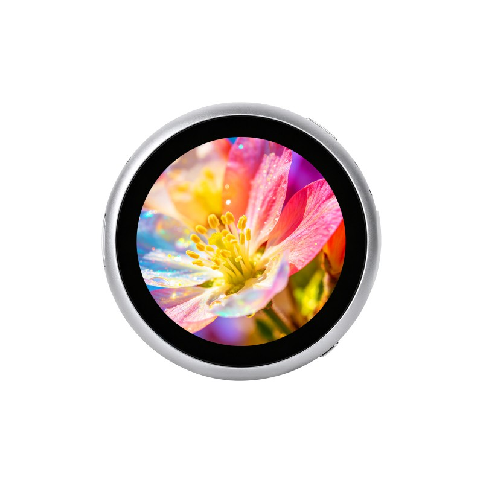

<div align="center">
  <h1>ESP32-S3-Touch-LCD-1.85B</h1>
  <p><strong>360 × 360 圆形触摸屏开发板，配备双麦克风、音频、运动传感器、RTC 和电池电量计</strong></p>
  <p><a href="README.md">English</a> | <strong>简体中文</strong></p>
  <p>
    <a href="https://github.com/waveshareteam/ESP32-S3-Touch-LCD-1.85B/actions/workflows/build.yml"></a>
    <a href="https://github.com/waveshareteam/ESP32-S3-Touch-LCD-1.85B/releases/latest"></a>
    <a href="LICENSE"></a>
  </p>
  <p>
    <a href="https://www.waveshare.net/shop/ESP32-S3-Touch-LCD-1.85B.htm">🌐 产品</a> &middot;
    <a href="Firmware/">📦 出厂固件</a> &middot;
    <a href="examples/esp-idf/">🧩 ESP-IDF</a> &middot;
    <a href="examples/Arduino-V3.2.0/">🔧 Arduino</a> &middot;
    <a href="hardware/">📚 硬件资料</a>
  </p>
  <p></p>
</div>

---

## ✨ 产品概述

ESP32-S3-Touch-LCD-1.85B 集成圆形触摸显示屏及音频、运动传感器、RTC、电池电量计和 microSD 接口。本仓库提供独立外设示例和完整出厂应用源码。

| 功能 | 器件 / 配置 |
| --- | --- |
| 主控 | ESP32-S3 |
| 存储 | 16 MB Flash、8 MB PSRAM |
| 显示与触摸 | 1.85 英寸，360 × 360 圆形触摸屏 |
| 音频 | ES8311、ES7210，双麦克风 |
| 传感器与时钟 | QMI8658、PCF85063 |
| 电池电量计 | BQ27220，500 mAh 电池配置 |

## 📦 快速开始

安装 ESP-IDF v5.5.4，进入所需示例目录，执行：

```sh
idf.py set-target esp32s3
idf.py build
idf.py flash monitor
```

各示例的接线、使用方法和预期结果见其 README。现有出厂二进制位于 [Firmware](Firmware/)，完整出厂应用请参阅[出厂源码说明](examples/factory/README_ZH.md)。

## 🧪 示例

### ESP-IDF

| 示例 | 功能 |
| --- | --- |
| [01_lvgl_demo](examples/esp-idf/01_lvgl_demo/README_ZH.md) | 圆形屏 LVGL、触摸与背光调节 |
| [02_sd_card](examples/esp-idf/02_sd_card/README_ZH.md) | 四线 SDMMC、文件读写校验及屏幕结果显示 |
| [03_qmi8658](examples/esp-idf/03_qmi8658/README_ZH.md) | 加速度、角速度及芯片温度 |
| [04_pcf85063](examples/esp-idf/04_pcf85063/README_ZH.md) | RTC 日历读取与设置 |
| [05_bq27220](examples/esp-idf/05_bq27220/README_ZH.md) | 电量、电压、电流及容量读取 |
| [06_mic_test](examples/esp-idf/06_mic_test/README_ZH.md) | 双麦克风音量条、录音及分通道回放 |
| [factory](examples/factory/README_ZH.md) | 完整桌面、设置、媒体应用和语音对话 |

六个基础示例和出厂工程使用相同的本地 BSP 实现，每个基础示例只初始化其所需外设。

### Arduino

原有示例及随附库位于 [examples/Arduino-V3.2.0](examples/Arduino-V3.2.0/)，保留原有使用方式。

## 🛠️ 开发环境

| 框架 / 库 | 版本 | 适用范围 |
| --- | --- | --- |
| ESP-IDF | v5.5.4 | 6 个基础示例及出厂工程 |
| LVGL | 9.5.0 | ESP-IDF 显示示例及出厂工程 |
| Arduino-ESP32 | 3.2.0 | 原有 Arduino 示例 |

## 📚 资源

- [硬件资料](hardware/)
- [产品页面](https://www.waveshare.net/shop/ESP32-S3-Touch-LCD-1.85B.htm)
- [产品 Wiki](https://www.waveshare.net/wiki/ESP32-S3-Touch-LCD-1.85B)

## 🤝 支持

- 示例或仓库问题：[提交 Issue](https://github.com/waveshareteam/ESP32-S3-Touch-LCD-1.85B/issues)。
- 产品使用与硬件问题：[微雪技术支持](https://service.waveshare.com/)。

## 📄 许可证

仓库采用 Apache License 2.0，见 [LICENSE](LICENSE)。第三方组件遵循各自目录中的许可证。
